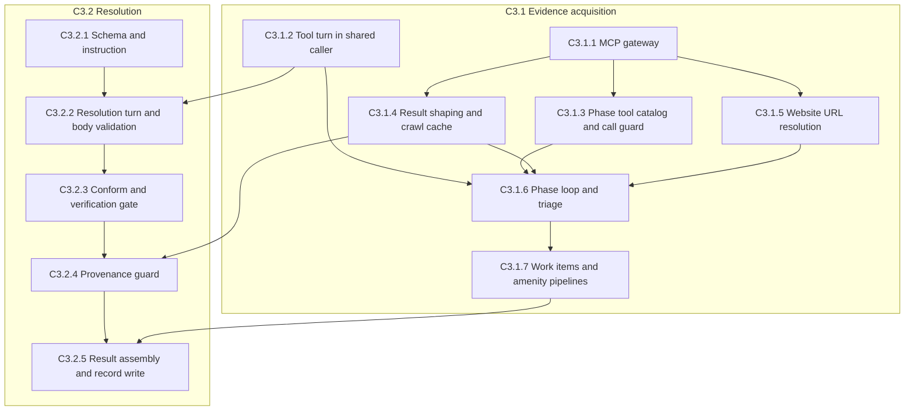

# R2 Mechanism 3 — Sub-Component Specs (C3.1 & C3.2)

> **Status: DRAFT FOR DISCUSSION.** This surfaces the initial draft so we can finalize specs sub-component by sub-component. Nothing here is implemented. This is not yet an approved implementation plan.

## Context

Feature **Deep Search**, Responsibility 2 (R2), **Mechanism 3** resolves metrics for discovered amenities. This document decomposes the two components defined in `r2_mechanism_3_final_a4b603ba.plan.md`:

- **C3.1 — Evidence acquisition.** Native function-calling loop: the shared `StructuredLLMCaller` sends tool schemas to the LLM, and the application executes each returned tool call through an MCP client (Parallel `web_search`, Firecrawl `firecrawl_crawl`).
- **C3.2 — Resolution.** A final structured turn, with no tools, whose evidence is the amenity's `metrics_source_content` (the per-metric evidence store built in C3.1) rather than the tool-call thread. It commits per-metric values.

The goal of this round is to **finalize the specs** of each sub-component before any implementation.

---

## Locked decisions (carried in, not reopened)

| ID | Decision |
|----|----------|
| D1 (revised) | The LLM decides when to call tools. Order: `web_search` for all metrics → triage → `firecrawl_map` then `firecrawl_scrape` (one scrape per unresolved metric) for unresolved metrics. |
| D2 | Hosted Streamable HTTP MCP servers with bearer keys. |
| D4 (revised) | **No** shared crawl per site. Each work item independently resolves its website (C3.1.5 discovery) and runs its own Phase-2 `map`/`scrape`; no crawl cache, no single-flight. (Supersedes the original "one shared crawl per site" — C3.1.5 / C3.1.7.) |
| D5 | A failed item gets `null` and the run continues. |
| D6 | One shared `StructuredLLMCaller`, owned by the composition root. |
| D7 | Scrape overrides web on contradiction. |
| RC7 | M3 runs on all M1 records. |
| RC8 | URL first, then the loop. |
| RC9 (revised) | Output is a separate `SpecificMetricsRecord` per amenity. C3.2.5 combines these with the `PredefinedMetricsRecord`s into one versioned `AmenityMetricsSet` (1.0). `AmenityRecord` → `PredefinedMetricsRecord`; `AmenityRecordSet` removed. |
| RC10 | Both tools are the specified sources of every LLM-defined metric. |
| — (revised) | M3's Firecrawl tools are `firecrawl_map` + `firecrawl_scrape` (Phase 2 = `map` → select → per-metric `scrape`). `firecrawl_crawl` is **retained in the gateway for future use but unused by M3** (C3.1.1). |

## Prerequisites — upstream changes this plan requires

**Principle:** any change this plan forces in an **already-implemented upstream mechanism** is listed here and must land **before (or together with)** M3 implementation, so M3 stays aligned with the dependencies it builds on. (Downstream *consumers* — C4.1 / C4.2 — are tracked in C3.2.5, not here, because they adapt to M3's output rather than gate it.)

**Mechanism 6 — metric definition**
- **RC10 — `resolution_source` gains both sources (schema change).** Today each metric's `resolution_source` is a single `{tool, target}` ([schemas.py:480](backend/src/services/deep_search/feature_schemas/schemas.py:480)); RC10 requires every LLM-defined metric to carry **both** a web and a scrape source. This is the existing RC10 dependency.
- **Verification-text authoring convention (prompt-only — no schema change) — MANDATORY clause.** `verification` is already a free-text field ([schemas.py:481](backend/src/services/deep_search/feature_schemas/schemas.py:481)), and [metric_definition_instruction.py:65](backend/src/services/deep_search/feature_prompts/metric_definition_instruction.py:65) currently shows a factual form (*"stated on the official site"*) and a review form (*"dominant sentiment across at least 5 reviews"*) **only by example**. **Required change:** make the source-acceptability clause **mandatory and explicit** in that prompt — **every** `verification` string MUST contain exactly one of: *"first-party/authoritative source only"* (factual → reviews rejected) **or** *"customer-review evidence acceptable"* (experiential → a review quote may satisfy it). This clause — not an example — is the factual/experiential switch the C3.2.1 Google-reviews fallback reads; C3.2 only applies the text it is handed. **No schema change — a prompt edit in `metric_definition_instruction.py`.** **M3-side safety net:** C3.2.1 treats any `verification` with no explicit review-acceptance clause as factual/reviews-blocked, so M3 is correct even before this edit lands — reviews simply stay **ineligible** until it does.

**Mechanism 1.3 — record assembly / state** (from C3.2.5, RC9 revised)
- Rename `AmenityRecord` → `PredefinedMetricsRecord`; remove `AmenityRecordSet`.
- M1.3 writes `state.predefined_records` as a plain nested dict (no envelope, no version); spec updated in `deep_search_context.md`.
- Retype `state.amenity_records` and add the two state fields M3 populates (`state.specific_records`, `state.amenity_records`). Full detail in C3.2.5 "Other changes outside M3."

---

## Research that shapes the sub-components

- **Parallel Search MCP.** `web_search` takes `objective` (string), `search_queries` (3–6 word queries, ≥1, 2–3 recommended, operators allowed), optional `session_id` (≤100 chars, reused within a conversation). Bearer key in `Authorization` header.
- **Firecrawl MCP.** `firecrawl_crawl` takes `url`, `limit`, `maxDiscoveryDepth`, `allowExternalLinks`.
  - Current README: the tool polls internally and returns final data. Older versions returned a job id, polled via `firecrawl_check_crawl_status`.
  - Crawl responses can be very large and overflow context → limit depth and page count.
  - Hosted endpoint and keys: Firecrawl's 3.29.1 changelog (2026-10-09) says hosted keyless access was removed and a request without a credential gets 401. Earlier, the keyless endpoint exposed only 3 tools and the crawl tool needed a key. Not verified live.
- **MCP Python SDK.** Session pattern `streamable_http_client(url, http_client=...)` with `ClientSession`, `list_tools()`, `call_tool(name, args)`. A failing tool returns `is_error` (does not raise). Auth headers via a caller-owned `httpx` client.
- **Tool-calling loop.** OpenAI chat completions and Groq share the message cycle. Assistant message carries `tool_calls`; the app returns one `role: tool` message per `tool_call_id`; loop ends when no `tool_calls` return. `parallel_tool_calls` defaults true. Groq does not support `strict` on function tools.
- **Current code.** `StructuredLLMProvider.generate_structured` builds a fixed system+user message pair (no history, no tool path). `AmenitySearch.__init__` takes only Places and Routes clients. The provider-chain fallback is private to R1.

---

## Dependency order



---

# Component C3.1 — Evidence acquisition

## C3.1.1 — Build the MCP Tool Gateway for Parallel and Firecrawl

**Goal.** Typed async operations over the two hosted MCP servers: `search_web(objective, search_queries)` → Parallel `web_search`; and for Firecrawl, `map_site(url)` → `firecrawl_map` and `scrape_page(url)` → `firecrawl_scrape` (the two M3 uses), with `crawl_site(url, limit, depth)` → `firecrawl_crawl` **retained for future use but unused by M3**. Each returns typed results or a typed failure. Sessions open/close in one async scope. The connect step verifies the expected tools and argument names exist.

**Problem.** R2 has no MCP client (no `mcp` dependency, no server keys). MCP returns generic content blocks, not typed data. A session is stateful and must open/close in the same async task. A server can rename/remove a tool; without a connect-time check, the failure surfaces mid-run.

**Finalized approach.** High-level `Client` wrapper — one `Client(transport)` per server, transport built with `streamable_http_client(url, http_client=...)`. The wrapper owns the session, handshake, and context management, and offers convenience methods. The `httpx` client carrying the `Authorization` header is created and owned by the gateway.

**Decisions — generally mandatory**
- **Session scope.** Sessions open at the start of `run_llm_metric_resolution` and close at its end, same task. Not opened in a constructor. `aclose()` closes a leaked session (as existing Google clients do).
- **Authentication.** Bearer keys from `Settings` (`PARALLEL_API_KEY`, `FIRECRAWL_API_KEY`). Keys never logged.
- **Retry & timeouts.** Retry 2 s then 3 s, transient failures only (timeout, transport error, rate limit). Per-call timeouts set per server.
- **Error typing.** `is_error` result → typed tool failure. Connection/protocol failure → MCP error family with `stage`.
- **Test seam.** Gateway is a `Protocol` injected into `AmenitySearch`; a fake stands in for tests.

**Decisions — problem-specific**
- **Capability check.** `tools/list` must contain `web_search` (args `objective`, `search_queries`) on Parallel and **`firecrawl_map` (arg `url`) + `firecrawl_scrape` (args `url`, `formats`)** on Firecrawl. A miss raises `McpToolUnavailableError` before any amenity work. **`firecrawl_crawl` is retained but NOT required** — it is left unchecked, so a map/scrape-only server still passes (a server missing map/scrape still fails here). A missing Firecrawl key is not caught by this check: per Firecrawl's changelog the hosted endpoint answers 401 without a credential, so the session cannot open and `open()` raises `McpConnectionError` first (not verified live).
- **Firecrawl map/scrape operations (M3 path).** `map_site(url)` calls `firecrawl_map` (app-injected homepage `url`) and returns the site's link set as a typed candidate list; `scrape_page(url)` calls `firecrawl_scrape` (`formats: ["markdown"]`, `onlyMainContent`) and returns one typed page. These are the only Firecrawl tools M3 drives; the LLM never supplies a URL (C3.1.3).
- **Result parsing — map/scrape (verified against the server source; both decode via the shared `_decode_body`).**
  - *scrape:* the MCP result **unwraps** the REST `{success, data:{…}}` envelope — page text is top-level **`markdown`**, page URL is **`metadata.sourceURL`** (NOT `data.markdown`). Per Firecrawl's API docs `sourceURL` is the URL that was **requested**; the post-redirect URL is the separate `metadata.url` (not live-verified). `scrape_page`'s typed result carries `(url = metadata.sourceURL, text = markdown)`. A result with no non-empty `sourceURL` is a failure (M3 keys/provenances scrape evidence by URL).
  - *map:* read **`links`** — an **array of objects** `{url, title?, description?}` on current Firecrawl; extract `url` (+ `title`/`description` when present to enrich the candidate list), and **tolerate a plain-string `links` form** defensively (older servers).
- **MCP result wrapping & `structuredContent` decode.** Both servers return the payload **twice**: a `content:[{type:"text", text:<pretty JSON>}]` block **and** a native `structuredContent` object (same data). `_decode_body` prefers the structured object then JSON-decodes the text block, so either wrapping yields the dict. **Confirm the `mcp` SDK's attribute name** — the wire field is camelCase `structuredContent`; today the code reads snake_case `structured_content`, which (if the SDK exposes camelCase) returns `None` and falls back to the text-JSON path (still correct). Read it by the real attribute name so the structured object is used directly — a robustness fix, not a correctness one.
- **Firecrawl output shape + live probe (part of this component's work).** M3 requires **MCP server 3.x JSON output** from Firecrawl: a JSON body (as `structuredContent` or as JSON in the text block) with top-level `markdown` and `metadata.sourceURL` for scrape, and a `links` list for map. Firecrawl MCP server 1.x and 2.x (up to 2.1.0) are reported to return raw joined text rather than JSON for scrape and never read `sourceURL`, which breaks URL keying/provenance and `_decode_body`. (This "3.x" is the MCP server package version. It is not a Firecrawl REST API version, none exists, and it is not the `/v2/` segment of the hosted URL. Source: public GitHub and docs research; not live-verified.) So on connect, after the capability check, **the component probes one `map_site` + `scrape_page` against the hosted endpoint and confirms that shape** (page text present + a non-empty `metadata.sourceURL`, map `links` parseable); a different shape raises `McpToolUnavailableError` before any amenity work rather than failing mid-run. We do **not** rely on a declared `outputSchema`.
- **Parallel `web_search` result (verified).** The MCP result mirrors the REST payload for the fields we read — `results[]`, each with `url`, `title`, and **`excerpts` as a list of strings** — so the existing search parser (`_parse_search_result` + the `excerpts`-list fallback in `_excerpt_text`) handles it unchanged. (`usage` moves to the result's `_meta`; we don't read it.)
- **Crawl result shape (retained crawl path — not used by M3).** Handle both shapes: final data after internal polling, and a job id polled via `firecrawl_check_crawl_status`. M3's map/scrape parsers are specified above; this applies only to the retained `crawl_site` op.
- **Crawl read timeout (retained crawl path).** Crawl uses a longer timeout than search. On timeout, read the job via `firecrawl_check_crawl_status` — do not restart the crawl. Requires capturing the crawl job id. (M3 scrape uses its own per-call timeout.)
- **Concurrent calls on one Client.** One `Client` per server, shared across amenity pipelines inside the single event loop; never across threads/loops. Concurrency capped by a per-server semaphore sized to the vendor rate limit. Every call wrapped in an explicit timeout. A timed-out/failed session is replaced by reconnecting in the owning task. A timed-out crawl is re-read, not repeated.
- **Rate limits.** One semaphore per server, sized to the vendor rate limit. Firecrawl limits depend on plan — confirm before raising the default.
- **Verification (split per server; if a test shows an issue, approach reviewed):**
  - *V2a Parallel:* ~10 concurrent `web_search` calls on one `Client`; each result matches its request; one timeout doesn't fail the others.
  - *V2b Firecrawl (M3 path):* several concurrent `scrape_page` calls on one `Client` after a `map_site`; each result matches its page; one scrape timeout doesn't fail the others; the session stays usable. (Crawl-interference checks apply only to the retained `crawl_site` path.)

## C3.1.2 — Add a Tool-Turn Call to the Shared `StructuredLLMCaller`

**Goal.** One `StructuredLLMCaller` holds the OpenAI-then-Groq chain and serves R1 and R2. It exposes the existing structured call unchanged, plus a tool turn taking (message history, function tool definitions, `tool_choice`) and returning the assistant message with its optional `tool_calls`. Same `LLM_PROVIDER_ORDER` fallback for both calls.

**Problem.** Provider fallback is private to R1's class, so `AmenitySearch` can't make LLM calls. Both provider classes build a fixed system+user pair (no history, no tool path). M3 needs a conversation where tool results are appended and re-sent. A second copy of the fallback would drift.

**Finalized approach.** Extend the provider protocol — add `generate_turn(messages, tools, tool_choice)` to `StructuredLLMProvider` and both provider classes. The caller loops over providers for either method.

**Decisions — generally mandatory**
- **Ownership.** Built once at the composition root, passed to R1 and `AmenitySearch`. Created and closed once.
- **Fallback rule.** Fallback on `LLMProviderError`, including a response cut short by token limit. Never for a returned invalid body.
- **Typed error.** The M3 call raises `MetricResolutionProviderError` with `stage`. R1 keeps its own error behavior.
- **Regression.** R1 behavior unchanged; a test covers the lifted helper against existing R1 cases.

**Decisions — problem-specific**
- **Message format.** OpenAI chat format (Groq-compatible), provider-neutral, so a fallback provider receives the same messages including prior `tool_calls` and `tool` messages with `tool_call_id`s.
- **No `strict` on function tools.** Groq doesn't support it → arguments validated in code (C3.1.3).
- **Tools vs structured output are separate requests.** Tool turns send `tools`, no `response_format`. Triage and C3.2 resolution send `response_format`, no `tools`. *Open:* whether each provider accepts both in one request (plan does not depend on it).
- **Parallel calls.** `parallel_tool_calls` stays on.
- **Truncated tool calls.** `finish_reason: length` with partial tool args → provider failure, not executed.

## C3.1.3 — Build the Phase-Scoped Tool Catalog and Call Guard

**Goal.** Per phase, the LLM receives only the valid tools: `web_search` in phase 1, `firecrawl_map` then `firecrawl_scrape` in phase 2. Every returned tool call passes a guard before reaching the gateway: checks name, validates args (incl. the scrape `id` and its required `metric_label`), dedups and caps Phase-2 scrapes, attributes the call to its metric(s), and sets every application-controlled argument.

**Problem.** MCP schemas let the caller set fields the app must control (the scrape/map `url`, scrape `formats`, etc.). Phase order is app-enforced; an instruction alone won't stop a wrong-phase call, and a wrong-phase / out-of-catalog call left in the replayed history breaks the next Groq request (see Guard failure handling). Evidence must be attributed to a metric (the `web_search` / `firecrawl_scrape` schemas have no metric field). Groq doesn't enforce function arg schemas → validate in code.

**Finalized approach.** Derived schemas with controlled fields removed — function schemas built from MCP schemas, application-controlled fields removed from the exposed schema. Code injects those fields and adds `metric_label`.

**Decisions — generally mandatory**
- **LLM-settable fields.** `web_search`: `objective`, `search_queries`, `metric_label`. `firecrawl_scrape`: an **`id`** (selecting a page from the map candidate list) + a **required `metric_label` (≥1; a list is allowed)** — the scrape `url` is **not** LLM-settable (app-resolved from the `id`; see Scrape/map clamps). `firecrawl_map`: no LLM-settable fields (its `url` is the app-injected homepage).
- **Guard failure handling.** An invalid call returns to the LLM as a `tool` message with error text. Not executed; does not count against the call cap (never hits the gateway). Run continues (D5). A guard rejection is still a failed attempt, so the one retry for that metric (phase 1) / the amenity's scrape (phase 2) remains allowed. Two sub-cases differ in how the call is carried in the replayed history (both answered 1:1 for the current turn — C3.1.4):
  - *In-catalog rejection* — a call to an **exposed** tool with bad args / bad `id` / bad `metric_label`: keep the assistant `tool_call` + its error `tool` message in history. The tool **is** in `request.tools`, so replay stays well-formed.
  - *Out-of-catalog rejection* — a call to a tool **not in the current phase's catalog** (wrong-phase, unexposed, or hallucinated): answer it 1:1 this turn, **but sanitize it out of the persisted history** before the next request (drop that `tool_call` from the assistant message and its paired `tool` message, or rewrite the assistant turn to plain text). **Verified-necessary:** Groq rejects the **next** request with `tool_use_failed` when a call to a tool not in `request.tools` remains in the replayed history; leaving it un-sanitized breaks the loop. (OpenAI tolerates it, but we sanitize for both.)
- **Unexposed tools.** Every MCP tool other than the phase's tool(s) — `web_search` (phase 1), `firecrawl_map` / `firecrawl_scrape` (phase 2) — is never exposed. (`firecrawl_crawl` is retained in the gateway but never exposed to the LLM.)

**Decisions — problem-specific**
- **Query rules in the tool description.** Concise related keyword queries 3–6 words, ≥1 per call, 2–3 diverse recommended, operators allowed. Guard rejects a call with no queries.
- **`metric_label` rule.** Must belong to the amenity's metric set; removed before the MCP call; a label outside the set is rejected.
- **Scrape / map clamps (map→scrape model).** `firecrawl_map`'s `url` is **app-injected** (the resolved official homepage from `website_search_results`, C3.1.5). `firecrawl_scrape`'s `url` is **app-resolved from the LLM's `id`** against the map candidate list. The LLM supplies **no** URL in either tool, so the draft's host-clamp (host normalization / netloc comparison) is **removed** — there is no LLM-supplied host to validate. The LLM decides *when* to scrape and *which page* (by `id`, D1) and tags each scrape with its `metric_label`(s); the app fills everything else.
- **Caps.** The phase loop (C3.1.6) enforces the attempt budget; the guard enforces the Phase-2 structural limits (≥1 `metric_label` per scrape, URL dedup, the 8-scrape ceiling). The cap counts only MCP calls that hit the gateway. Phase 1: one `web_search` + one retry per metric. Phase 2: one `firecrawl_map` (+ one retry), then **one `firecrawl_scrape` per unresolved metric, deduped by URL to ≤ 8 distinct scrapes per amenity**, each scrape + one retry. Retry allowed only when attempt 1 failed, timed out, or was guard-rejected. A successful attempt 1 is not retried even if metrics remain unresolved. Worst case bounded: ≤2 gateway searches per metric; ≤ (1 map + 8 scrapes) × 2 gateway Firecrawl calls per amenity; a guard rejection spends neither.
- **Phase 2 availability.** The `firecrawl_map` / `firecrawl_scrape` tools are offered only when a URL exists AND ≥1 metric is unresolved.

## C3.1.4 — Shape Tool Results

**Goal.** Every tool call becomes exactly one `tool` message carrying status `ok` / `empty` / `failed` plus the tool's result — never an exception, never an absence. Operating on the gateway's already-resolved outcome, classify in fixed order: confirm clean termination first, only then check content presence (`ok`) or absence (`empty`); anything the gateway marks as not cleanly terminated is `failed`. The result is always passed through alongside its status.

**Problem.** The loop requires exactly one `tool` message per call — a failed/empty/exception call can't be an absence (dangling tool call malforms the next turn). `empty` vs `failed` demand different reactions and must not collapse: `failed` justifies the one retry; `empty` is final and must not consume it. They also carry different meaning to C3.2: `empty` → confident `no_evidence`; `failed` → tool-failure reason. `empty` must never be assigned to a call that didn't genuinely finish with nothing.

**Finalized approach.** Status-signal first, content second (ordered guard). On the resolved outcome: first "did it terminate cleanly?" (error / `is_error` / gateway-marked failure → `failed`); only on confirmed clean termination, "is there content?" (→ `ok` with result, or `empty`). Same guard for every tool; result always passed through.

**Decisions — generally mandatory**
- **Outcome form.** Every tool call → exactly one `tool` message with status + result. Never an exception, never an absence.
- **Ordered guard: termination before content.** The content check is unreachable until clean termination is confirmed — this guarantees `empty` is only ever a genuinely-contentless call.
- **Termination signal is the sole source of `failed`.** Error / `is_error` / gateway-marked failure → `failed` at stage one, regardless of any partial/blank payload. Payload content never influences `failed`.
- **Retry alignment.** `failed` is eligible for the single C3.1.3 retry; `empty` is terminal and consumes none. (Retry owned by C3.1.3; this component only supplies the gating status.)

**Decisions — problem-specific**
- **Operates only on a resolved outcome.** No MCP call, no job polling, no waiting — all call mechanics (incl. driving a polled crawl to completion) belong to the gateway (C3.1.1).
- **Result always passed through.** Status is a label, not a filter; content never stripped/withheld/interpreted. What to do with empty/failed is the consumer's decision.
- **Depends on the gateway distinguishing "finished empty" from "never finished."** A timed-out / never-arrived call must arrive here already marked a failure, not an empty payload. The "exhausted/unknown → `failed`, not `empty`" guarantee is a requirement on the gateway's output.
- **Status meaning carried to C3.2.** `empty` → confident `no_evidence`; `failed` → tool-failure reason.

## C3.1.5 — Resolve the Official Website URL Before the Loop

**Goal.** Before the LLM loop runs, produce a resolved `website_search_results` object per work item holding `website_url` and `website_origin` (`google` / `discovered` / `none`). If `PredefinedMetricsRecord.website` is set **and is an official first-party host**, use it. Otherwise one discovery step runs → a confirmed official site or `none`. `PredefinedMetricsRecord.website` is never changed.

**Problem.** Google's `websiteUri` is sometimes absent, and is sometimes a social/aggregator host rather than the official site. Phase 2 needs an official URL to crawl. RC8 requires URL-first. A wrong site produces wrong crawl evidence.

**Finalized approach — Approach 2: one search, LLM selection.**
Discovery is a **self-contained prerequisite step, not a phase.** It does not share the phase loop's budget, triage, or machinery; it runs to completion before any amenity loop starts and produces an input to it. Mechanism:
1. **Tool turn** exposing *only* `web_search` — the **LLM builds the search args** and makes the call through the gateway (the one place in the flow where the LLM chooses the search arguments). The amenity identity (name, locality) is given to the LLM as the matching target; the query is **grounded on the postal code** parsed from the Google-address field so results are scoped to the target locality.
   - **Input source (finalized).** All discovery inputs are read from the work item's **`PredefinedMetricsRecord`** — the M1 record at `state.predefined_records[category_id][place_id]` (looked up by the work item's `(category_id, place_id)`; the work item itself carries only the key, not these fields). The fields used: **`name`** and **`website`** (the candidate Google `websiteUri`), plus the **`address`** field from which **locality** and **postal code** are parsed. No other object is read for discovery.
2. **Structured selection turn** (`response_format`, no tools) where the LLM returns a Pydantic-validated verdict — the official `website_url` or `null` — judged from the raw search results (URLs + per-result snippets). The LLM has no per-candidate address/phone; it evaluates snippets against the amenity identity.

Because this switches from code-built to LLM-built args + a structured verdict, discovery now depends on **C3.1.2** (tool turn) and **C3.1.3** (guard) and needs a small schema (à la C3.2.1), in addition to **C3.1.1** (gateway).

**Host rule — binary.** An **official first-party site** → `website_url` + eligible for crawl. **Everything else** (social, aggregator, directory/listing, maps, review) → `none`, **no crawl**. There is no middle "aggregator → crawl anyway" class. This makes phase-1 query scoping always safe, since a non-null `website_url` is always an official site. The instruction's one judgment: *"is this the amenity's own first-party official site? If not, return `none`."*

**Google-provided URL handling.** The trust rule is **revised** from the draft's "use as-is, not re-checked": a Google `websiteUri` is trusted **only if it is an official (non-social, non-aggregator) host**. A social/aggregator Google URL is treated as *absent* → discovery runs. (This reopens the draft's locked "trust as-is" rule — intentional.)

**Decisions — generally mandatory**
- **Failure vs empty (mirrors C3.1.4).** *Tool call failed* (gateway failure) → one retry, then `none`. *Search returned results but the LLM found no official site* → terminal `none`, **no retry** (a confident decision). *Pydantic-invalid verdict* → treated as **failed → one retry** of the **selection turn only** (re-send the raw results already in hand; no second `web_search`); still invalid → terminal `none`. This same-provider retry is distinct from C3.2.2's provider-level fallback.
- **Budget.** The discovery `web_search` is one real gateway call; it does **not** consume any metric's phase-1 attempt or the amenity's crawl retry. It runs under the Parallel search semaphore; its selection turn runs under the LLM-call bound.
- **Where the result lives.** The resolved `website_search_results` object, keyed `(category_id, place_id)`. Raw search candidates live transiently in the conversation (read by the LLM to decide); only the resolved, structured verdict is persisted. Downstream (phase-1 `web_search`, phase-2 `firecrawl_crawl`) reads the URL from this object as read-only context.

**Decisions — problem-specific**
- **Precision over recall.** An unconfirmed candidate → `none`. Never invent a URL.
- **Always-produce rule.** The object is always created, one per work item. When a non-social Google `websiteUri` provides the URL, `website_url` + `website_origin=google` are **populated from Google** and only the discovery-specific (raw-result-derived) fields are null (no search ran).
- **No dedup across categories.** One physical place appearing under two categories = two work items (same `place_id`, different `category_id`). Each work item runs **its own** discovery (duplication accepted; single-flight intentionally *not* used).
- **URL format.** Handled by the instruction + a one-shot example + the schema-field description (no separate code normalization pass). Pydantic `HttpUrl` is the type backstop; a malformed value → failed → retry. No crawl host-clamp is needed because the crawl `url` is **app-injected** from this object (see C3.1.3 edit), so there is never an LLM-supplied host to compare.
- **Effect of `none`.** Phase 2 skipped for this amenity (no official URL to crawl); metrics rely on web evidence. Phase 1 still runs. When a URL **is** present, phase 1 **also** uses it — folding the host into some queries to scope them to the official site — but *in addition to* broader off-site queries, not as a replacement (web and scrape must stay complementary per D7; hard-scoping every query collapses web evidence onto the site).

**Batch orchestration — finalized: `asyncio.gather` + semaphore (Option A).**
All discoveries run **concurrently, before the loop, behind a hard barrier.** Build one discovery coroutine per work item, each wrapped in `async with discovery_sem`; `await asyncio.gather(*tasks, return_exceptions=True)` is the barrier — the loop starts only after it returns. Each task has a per-call timeout and swallows its own failure. Post-processing maps any exception slot or timeout → a `none` discovery result, collected into the dict keyed `(category_id, place_id)`. Because the loop has not started, discovery gets the full Parallel rate budget with no phase-1 contention.

> **Open item:** the **postal-code degrade path** — when Google returns no postal code (rural / some international), degrade `postal code → locality/city → name-only`; a missing postal code must not block the search. Also decide whether the postal code is *injected* into the objective deterministically (hard grounding) or *instructed* to the LLM (soft).

## C3.1.6 — Run the Phase Loop and Triage per Amenity

**Goal.** For one amenity: run phase 1 (LLM + `web_search` rounds) until the LLM stops calling tools or each metric's search budget is spent; run the triage turn (`sufficient`/`unresolved` per metric); run phase 2 (LLM + Firecrawl `map` → select → `scrape`) only when ≥1 metric unresolved AND a URL exists, until the LLM stops calling tools or the phase-2 budget is spent. Return the full conversation and the `metrics_source_content` store.

**Problem.** Nothing drives the assistant/tool-call/tool-result cycle today. Phase switching, loop termination, and the crawl decision need defined rules. The LLM's "settled" judgment must become a readable field. Tool failures must not stop the amenity or run.

**Finalized approach — Split loops (phase-1 loop, phase-2 loop).**
Two dedicated loop functions with triage as an explicit step between them; each loop hardcodes its own tool and budget. The orchestrator runs `phase1_loop → triage → (conditionally) phase2_loop`. This keeps each phase's rules read in isolation and lets the two phases evolve independently, at the cost of some duplicated message-cycle boilerplate across the two loop bodies (acceptable, and a shared helper for the raw assistant↔tool-call↔tool-result cycle can absorb most of it without merging the phases).

**Triage capture mechanism (settled):** a **separate strict-schema no-tools request** between the two loops — the finalized triage decisions below (closed-enum structured response + retry-twice robustness) require it; free-text-JSON-in-message can't guarantee the closed schema, and a `report_triage` tool call would fight C3.1.2's tools-vs-`response_format` separation.

**Decisions — generally mandatory**
- **Termination.** The loop enforces the attempt budget. A phase ends when the assistant returns no `tool_calls`, or when that phase's budget is spent. Before a call reaches the gateway, the loop checks this metric/amenity still has an attempt; a call with none left isn't executed. Phase 1 budget is spent for a metric when its search **terminates cleanly — `ok` *or* `empty` (C3.1.4)** — or its one retry is used. Phase 2 follows the multi-step phase-2 budget in the Phase 2 scope below (`map` + **one `scrape` per unresolved metric**, deduped by URL to a **hard ceiling of 8 distinct scrapes per amenity**, each scrape with one retry). **Only a `failed` outcome, a timeout, or a guard rejection is retry-eligible; an `empty` result is terminal and is never retried (C3.1.4).**
- **Concurrency.** Tool calls in one turn run together with `gather` under the per-server gateway semaphores (Parallel for search, Firecrawl for crawl). Calls are **async-native on the event loop, no thread offload** (C3.1.1). Results appended in `tool_call_id` order.
- **Failure handling (D5).** Every tool call is shaped by **C3.1.4** into exactly one `ok`/`empty`/`failed` `tool` message; the loop appends it and continues. Only `failed` is retry-eligible; `empty` is terminal. A provider-chain failure for the amenity marks its metrics unresolved for C3.2; the run continues.
- **Conversation state.** One message list per amenity, provider-neutral format (C3.1.2). The split loops are **not** separate conversations: `phase1_loop`, the triage request, and `phase2_loop` all read and append to this **single shared message list** — "split" refers to the two loop *functions*, not the conversation.

**Decisions — problem-specific**
- **Phase 1 instruction content.** Amenity identity, the resolved `website_url` from the `website_search_results` object (C3.1.5) when present, and every metric with `label`, `question`, `value_type`, `unit`, `enum_values`, `verification`, and the web `resolution_source.target`. Told to search for all metrics and tag each call with `metric_label`. **When a `website_url` is present**, instruct the LLM to include at least one host-scoped query **alongside** broader off-site queries *within the same `web_search` call's `search_queries`* — never scoping every query to the host (web and scrape stay complementary per D7, per C3.1.5).
- **Coverage.** A metric no phase-1 call was tagged with is set `unresolved` by the app, whatever triage says.
- **Triage schema & output integrity.** Static, strict, closed **structured response**: `metric_label` + `status`, where `status` is a closed enum of exactly `sufficient` / `unresolved`. The schema is what guarantees label/status integrity. Labels are checked against the metric set; a body that omits a submitted label fails the label-set check and is handled by the robustness rule below.
- **Triage call robustness.** A schema mismatch / invalid body is rejected and **retried up to twice**. If it still fails, **every metric is treated as `unresolved`** (safe default) and the amenity continues (phase 2 then runs for any metric with a URL).
- **Triage rule & judgment quality.** A metric is `sufficient` only if evidence meets its `verification` rule. Triage is an opinion; C3.2 still gates each value. Judgment quality is ensured by **detailed instruction**: the triage prompt carries **one-shot examples and explicit edge cases** so the LLM makes the `sufficient` / `unresolved` call consistently.
- **Evidence-state → `unresolved`.** A metric whose phase-1 searches were all `empty` (genuine no-evidence) **or** all `failed` is `unresolved` — both map to `unresolved`. (The `empty` vs `failed` distinction is preserved by C3.1.4 for C3.2, not by triage.)
- **Incomplete evidence (spent budget).** When phase 1 ends on a spent budget while the LLM still wanted to search, triage runs normally on the evidence that exists; any metric that obtained no value is `unresolved`.
- **`metrics_source_content` shape (finalized — metric-keyed map).** The store is **scoped to the amenity pipeline** (no `(category_id, place_id)` key — identity is ambient and carried on the returned `SpecificMetricsRecord`) and is a **metric-keyed map**: `{ metric_label: { (source_kind, url): {shaped_text, retrieved_at} } }`, `source_kind` ∈ `web` / `scrape`. A piece of evidence lives under **every metric it was gathered for** — web: the one metric its search targeted; scrape: each metric the page was tagged with — a URL requested for several metrics is **fetched once** and the single result is **fanned out** under each requesting metric's key (C3.1.3 dedup + fan-out). Because web excerpts are objective-scoped, the **same URL under two metrics holds different `shaped_text`** and the two never collapse; a scrape page serving two metrics appears under both keys (identical text — a transient in-memory duplication, accepted). **Google reviews are kept separate** as one amenity-level block `{shaped_text, retrieved_at}` with **no metric**, passed to every metric at resolution. *(Persistence, if ever needed — Approach B: one `evidence` row per distinct `(source_kind, url, shaped_text)` under a surrogate `evidence_id`, with an `evidence_metric` join table for the metric links; `url` is non-unique and never the key; a reviews row carries no join link.)* Consequence for C3.2.4: a metric's quote is provenance-checked against **that metric's** bucket (so same-URL excerpts route to the right metric), and `support`/`as_of` come from the bucket entries the surviving quotes cite.
- **Phase 2 scope (finalized — `map` → select → `scrape`).** A uniform tool-calling loop (D1 preserved), not a single crawl. The instruction names the unresolved metrics and their firecrawl `resolution_source.target` hints.
  - **Tools:** `firecrawl_map` + `firecrawl_scrape` — the gateway operations, result parsers, capability check, and shape probe all live in **C3.1.1** (crawl retained there, unused by M3); this section only drives the loop over them. The LLM's **first Phase-2 tool call is `firecrawl_map`** (app-injected `url` = the resolved official homepage from `website_search_results`); map returns the site's link set, no page content. The app shapes it into an **id + URL candidate list** (opaque ids, issued fresh per map result, selection-only) returned as the `tool` message.
  - **Selection via id-indirection (per-metric):** the LLM emits `firecrawl_scrape` tool calls **one page per unresolved metric** — each call carries an `id` (**never a URL**) plus a **required `metric_label` (≥1; a list is allowed** when one page serves several metrics). The guard (C3.1.3) validates each id against the issued set (unknown / out-of-range → guard failure, not executed), **requires at least one `metric_label`** (an untagged scrape is rejected — no orphan), **dedups by resolved URL across all requests**, enforces the **hard ceiling of 8 distinct scrapes per amenity** (surplus dropped → those metrics stay on web evidence), then **substitutes the real URL verbatim** before the call reaches the gateway. URL stays app-controlled; URL text never passes through the model. Scrapes run concurrently under the Firecrawl semaphore via `gather`.
  - **Budget (multi-step):** `map` (1 call; `failed`/timeout → one retry, then give up Phase 2 → metrics stay on web evidence) → **selection turn** (invalid → one retry; still invalid → empty selection → no scrape, web-only) → **the deduped scrape set** — one page per unresolved metric, collapsed to **≤ 8 distinct URLs** (each scrape: `failed`/timeout → one retry, still `failed` → skip that page, don't fail the amenity; **`empty` → normal continuation** — the empty `tool` message is appended and the loop carries on, not retried, not a skip; C3.1.4). A scrape's `failed`/`empty`/retry is decided **per fetch**, shared across every metric that requested that URL.
  - **Dedup + fan-out cycle (finalized — build exactly this way):**
    1. **Collect** — from the selection turn, gather every `(metric_label, id)` request (one page per unresolved metric; a request may list several metrics).
    2. **Resolve** — map each `id` to its real URL via the candidate list.
    3. **Dedup by URL** — group requests by resolved URL → **one `firecrawl_scrape` per unique URL**, carrying the **union** of the metrics that asked for it (a URL requested for three metrics is scraped **once**, not three times).
    4. **Ceiling** — if the unique-URL set exceeds **8**, drop the surplus (those metrics stay on web evidence).
    5. **Fetch once** — run the ≤ 8 scrapes concurrently (Firecrawl semaphore); each URL's `ok`/`empty`/`failed` + its one retry is decided **once**.
    6. **Fan out after results** — write the single shaped result under **each** requesting metric's key in `metrics_source_content` (identical text per metric — accepted transient duplication); a `failed`/`empty` fetch fans out the same way (each requesting metric simply gets no entry from that URL).
    This is the one place the many-to-many (page ↔ metrics) is resolved: **fetch is per-URL, attribution is per-metric.**
  - **Best-effort (accepted constraint).** "One scrape per unresolved metric" guarantees an *attempt*, not evidence. A metric can still end `no_evidence` when `map` surfaced no plausible page, the URL-only page guess was wrong (`map` returns no content preview), or the scraped page simply lacks the answer. Accepted (D5).
  - A successful Phase 2 isn't repeated. **No second triage.**
  - **Candidate-list bounding before selection (finalized).** The `map` result is trimmed to **at most 50 candidate `(id, url)` pairs** before it is shown to the LLM for selection. If `map` returns more, the app caps the list at 50 (a path pre-filter / `map search` may inform *which* 50, but the ceiling is 50).
- **Skip cases.** Phase 2 skipped when every metric is `sufficient`, or `website_search_results.website_url` is `None` (C3.1.5).

## C3.1.7 — Plan Work Items and Run Amenity Pipelines

**Goal.** `run_llm_metric_resolution` on `AmenitySearch` builds one work item per `(category_id, place_id)` in `state.discovered_places` whose category has ≥1 `specific_metrics` entry (RC7). Each item takes `category_id`, `taxonomy_node`, `depth`, `specific_metrics` from the category's `CategoryMetricPlan`, and `place_id` from the `discovered_places` key. It then runs the **C3.1.5 discovery batch** over all work items (concurrent, behind a hard barrier) to populate each work item's `website_search_results` (RC8: URL first, then the loop), and only after that barrier returns runs the amenity pipelines (C3.1.6) concurrently under bounds, passing each finished conversation + `metrics_source_content` to the per-amenity C3.2 steps (C3.2.2–C3.2.4) as it completes. Each pipeline returns its `SpecificMetricsRecord` and writes no shared state. The `gather` waits for every pipeline before C3.2.5 runs.

**Problem.** M1 records carry no metric info (metrics live on `CategoryMetricPlan.specific_metrics`). Eligibility/identity/sharing across categories must be defined. Many amenities run together → concurrency needs a bound and one failure must not cancel others. `AmenitySearch` has no LLM caller, no gateway, no M3 entry method.

**Finalized approach — Approach 1: pre-indexed join + `gather`.**
Build `plan_index` (`category_id` → `CategoryMetricPlan`) once, derive the work-item list from it + `state.discovered_places`, then run all amenity pipelines with `asyncio.gather(*tasks, return_exceptions=True)`. The `gather` **is** the hard barrier before C3.2.5; `return_exceptions=True` together with each pipeline catching its own failure (returning a `SpecificMetricsRecord` whose metrics are `unresolved`, D5) gives **per-amenity failure isolation**. Chosen for consistency with C3.1.5's discovery batch (`gather`+semaphore) and C3.2.5's "combine once after the `gather`."

**Trace flow (`run_llm_metric_resolution`):**
```
run_llm_metric_resolution(state)                         [C3.1.7, method on AmenitySearch]
│
├─ open gateway sessions (Parallel + Firecrawl)          [C3.1.1 — session scope = method]
│
├─ STEP 1  Build plan_index  (category_id → CategoryMetricPlan)      ── once
│
├─ STEP 2  Derive work items  = eligible (category_id, place_id)      [RC7]
│          from state.discovered_places × categories with ≥1 specific_metrics
│          work_items = [ (cat, place, taxonomy_node, depth, specific_metrics), ... ]   (N items)
│
├─ STEP 3  DISCOVERY BATCH  (C3.1.5)                      ── concurrent, own hard barrier
│          inputs per wi ← PredefinedMetricsRecord = state.predefined_records[cat][place]
│                          (name, website, address→locality/postal)
│          tasks = [ discover(wi) for wi in work_items ]
│          await asyncio.gather(*tasks)        async with discovery_sem (Parallel pool)
│          → website_search_results[(cat,place)] = {website_url|None, origin}
│          ╌╌╌ barrier: ALL discoveries done before any pipeline starts (RC8) ╌╌╌
│
├─ STEP 4  AMENITY PIPELINES  (C3.1.6 + C3.2.2–C3.2.4)    ── concurrent, under bounds
│          tasks = [ pipeline(wi, website_search_results[key]) for wi in work_items ]
│          results = await asyncio.gather(*tasks, return_exceptions=True)
│
│   each pipeline(wi)  ── runs independently, writes NO shared state ───────────────┐
│   │                                                                               │
│   │  phase1_loop  → triage → (cond.) phase2_loop            [C3.1.6]              │
│   │     web_search turns     map→select→scrape turns                              │
│   │     (LLM permit per call; Parallel/Firecrawl permits per tool call)           │
│   │  builds its own conversation + metrics_source_content                         │
│   │  → C3.2.2 resolution turn → C3.2.3 conform → C3.2.4 provenance                │
│   │                                                                               │
│   │  try:     return SpecificMetricsRecord(resolved/unresolved metrics)           │
│   │  except:  return SpecificMetricsRecord(all metrics unresolved)   [D5]         │
│   │           ── failure caught INSIDE the task → isolated, siblings unaffected   │
│   └───────────────────────────────────────────────────────────────────────────── ┘
│
│          ╌╌╌╌╌╌╌╌╌  HARD BARRIER  ╌╌╌╌╌╌╌╌╌
│          gather returns only when ALL N pipelines have finished
│          (a "failure" still finished — it returned a record; D5)
│          return_exceptions=True → an unexpected raise comes back as a value,
│                                    not a cancel of the other tasks
│
├─ STEP 5  Post-gather sweep                               ── single-threaded, after barrier
│          for r in results:
│             if isinstance(r, Exception):  → synthesize all-unresolved record  [D5 safety net]
│             else:                          → r is a SpecificMetricsRecord
│
├─ STEP 6  C3.2.5  COMBINE  (run-level, runs exactly once)
│          store state.specific_records[cat][place] = record
│          pair with state.predefined_records → AmenityMetricsRecord
│          build versioned AmenityMetricsSet (1.0) → state.amenity_records
│          (N = 0 → set still built, every specific = None)
│
└─ close gateway sessions (aclose)                         [C3.1.1]
```
Two separate `gather` barriers: STEP 3 (discovery must finish before any pipeline — RC8) and STEP 4 (all pipelines must finish before C3.2.5). Failure isolation is two-layered: each pipeline catches its own failure and returns an unresolved record (primary, D5); `return_exceptions=True` is the backstop for an *unexpected* raise, which the STEP 5 sweep converts into an all-unresolved record. No shared-state writes occur inside STEP 4 — pipelines return records by value; the only run-level writes happen in STEP 6, after the barrier.

**Decisions — generally mandatory**
- **Placement.** `run_llm_metric_resolution` is a method on `AmenitySearch`, called after `run_result_attachment`.
- **Wiring.** Shared caller and gateway injected at the composition root (`create_amenity_search`). `aclose()` closes the gateway. The caller is closed once, by its owner.
- **Bounds.** Per-server semaphores — **Parallel** (search, shared by the discovery batch and phase 1) and **Firecrawl** (`map`/`scrape`, replacing the old crawl semaphore) — plus an LLM-call bound and a cap on amenity pipelines in flight. Starting values configurable, not measured. A separate **per-amenity ceiling of 8 distinct scrapes** (enforced by the C3.1.3 guard) bounds Phase-2 fan-out independently of the global Firecrawl semaphore.
- **Failure isolation.** One amenity's failure doesn't cancel others. Only a gateway-level failure (cannot connect, expected tool missing) raises.

**Decisions — problem-specific**
- **Eligibility.** Non-empty `specific_metrics` at any depth. A `basic_profile` category with none yields no work item.
- **No narrowing step.** M3 runs on all M1 records. Candidate selection (R3) not implemented; may move ahead of M3 later.
- **Pre-loop discovery batch (C3.1.5).** Before any amenity pipeline starts, `run_llm_metric_resolution` runs the discovery batch over all work items (`asyncio.gather` + `discovery_sem`, hard barrier) and populates each work item's `website_search_results`. Pipelines start only after the barrier returns. Each discovery reads its inputs (`name`, `website`, and the `address` field → locality/postal code) from the work item's **`PredefinedMetricsRecord`** at `state.predefined_records[category_id][place_id]` (C3.1.5 "Input source").
- **Two categories, one place.** Two work items (metrics differ). Each runs its **own** discovery (C3.1.5 — no dedup, no single-flight) and its **own** Phase-2 `map`/`scrape` — **there is no shared crawl cache**. (Supersedes the draft's "share one crawl via the cache"; **D4 revised** accordingly — no shared crawl per site.)
- **Session lifetime.** Gateway sessions open at method start and close at its end — covering both the discovery batch and the amenity pipelines.
- **Logging.** Pipeline start/end, tool-call outcome and duration, triage result, phase-2-skipped — without keys or evidence text.

---

# Component C3.2 — Resolution

## C3.2.1 — Define the Resolution Schema and Instruction

**Goal.** One strict JSON schema for the resolution turn + one instruction module stating decision rules. Schema returns one entry per submitted metric label. `build_resolution_instruction(json_schema)` produces the final-turn instruction.

**Problem.** No output wire contract for M3. Contradiction/sufficiency/quoting rules exist only as prose. Both providers apply strict schema limits; a static schema can't carry per-metric enums. The resolution turn runs after tool results that may contain untrusted text.

**Finalized approach — Approach 2: one static schema with a typed-union `final_value`.**
A single static schema (not generated per amenity). `final_value` is a **typed union of `string | number | boolean | null`**, covering the four shapes a metric value can take (text, number, boolean, or no value). Per-metric **enum membership, `unit`, and `value_type`** conformance is **not** in the schema — a static schema can't carry per-metric enums, so that stays a **code check in C3.2.3**. Fields: `metric_label`, `web_value`, `scrape_value`, `relation`, `final_value`, `basis`, `verification_met`, `evidence`.

**Decisions — generally mandatory**
- **Schema limits.** All keys required, closed objects, closed enums, no `minLength`/`minItems` — the same limits as Mechanism 6.
- **Builder pattern.** `build_resolution_instruction(json_schema)` in a dedicated instruction module, as in earlier mechanisms.
- **Examples.** Worked examples in the instruction are not reused as a sample-runner seed.

**Decisions — problem-specific**
- **Value typing (Approach 2).** `final_value` is the typed union `string | number | boolean | null`. `web_value` and `scrape_value` are **descriptive strings the LLM writes** (they don't map to any existing data-object field, so no per-metric typing is needed on them). `verification_met` is boolean; `relation` / `basis` are the fixed closed enums below; `evidence` is a structured object. Per-metric `enum`/`unit`/`value_type` conformance of `final_value` is deferred to C3.2.3 (code).
- **Field order.** `web_value` and `scrape_value` before `final_value`, so both source values are extracted before the commit.
- **Contradiction rule (D7).** A non-null `scrape_value` is the `final_value`, even contradicting `web_value`. `web_value` used only when `scrape_value` is null.
- **Verification rule.** `verification_met` false when evidence doesn't satisfy the metric's `verification` text; `final_value` then null.
- **Google reviews as a fallback value source (verification-gated — finalized).** Reviews are already supplied to the resolution turn as a labeled block (**not** a tool, never fetched; the tool catalog and `resolution_source` are unchanged). Instruction rule: *"Resolve each metric from the tool evidence (web/scrape) first, applying the metric's `verification` rule. Set `final_value` from the Google-reviews block **only when no tool value satisfies that rule** (tools returned nothing, or only evidence that fails verification) **and** a review quote does satisfy it. Cite `source=google_reviews`."* The per-metric **`verification` text is the factual/experiential switch** (Mechanism 6 authoring convention): factual rules reject reviews; experiential rules let a review pass. A review-sourced value sets `basis=google_reviews` and is `single_source` (C3.2.4). Tools may still resolve experiential metrics when a tool value passes the experiential verification — reviews fill only the gaps (not "experiential ⇒ reviews-only"). **Safety net:** if a metric's `verification` text does **not** explicitly permit review evidence, reviews are **not eligible** (default = factual / first-party-only) — so M3 is correct even before the Mechanism 6 verification-authoring prompt edit lands (see Prerequisites). **RC10 light-touch:** `resolution_source` still names only the two tools; reviews are a resolution-time fallback, not a specified source (no schema reopen).
- **Relation / basis enums (trimmed, + reviews).** `relation`: `agree`, `refined_by_scrape`, `conflict`, `none`. `basis`: `web`, `scrape`, `both`, `google_reviews`, `none`. `web_only`/`scrape_only` are dropped from `relation` (a single-source value is recoverable from `basis` = `web`/`scrape`); `verification_rule` is dropped from `basis` (the "why null" is carried by `verification_met` + the downstream `unresolved_reason`); **`google_reviews` is added to `basis`** for a value set from the reviews fallback above. **`relation = none`** means *no cross-source relationship* — fewer than two source values are present (only-web, only-scrape, or neither; a review-only value is also `relation=none`); it must be read **together with `basis`**, and the instruction must define it this way so the model doesn't conflate "no relationship" with "no value." The C3.2.3 consistency check reads `relation` + `basis` together.
- **Evidence items.** `source` (`web`/`scrape`/`google_reviews`), `url` (string|null), verbatim `quote`.
- **No numeric confidence.** Trust carried by `support` (C3.2.4) and the quotes.
- **Untrusted content rule.** Instructions in tool results are ignored. Amenity Google reviews supplied as a labeled block.

> *Schema approach finalized: Approach 2 (static schema, typed-union `final_value`).*

## C3.2.2 — Run the Resolution Turn and Validate the Body

**Goal.** Build the resolution turn from the amenity's `metrics_source_content` — **not** from the tool-call thread. For each submitted metric, present that metric's evidence bucket (`metrics_source_content[label]`) plus the amenity-level Google-reviews block when reviews exist (C3.2.1, shown to every metric). Append the resolution instruction and this evidence, then call the shared caller with the resolution schema and no tools (reviews are a labeled block, not a tool). Return a body matching the schema and covering exactly the submitted labels, or a typed per-amenity failure. Skip the call only when no metric has any usable evidence (see Skip rule).

**Problem.** The call can fail (provider error, truncation) or return an invalid body. The body can miss/repeat/add a label. D5: one amenity's failure must not stop the run. A no-evidence call is cost with no output.

**Three common approaches**
1. Model validation, then label-set check (whole body rejected on any mismatch).
2. Per-entry validation (valid entries kept; missing/extra/invalid → only those labels unresolved).
3. Hand-written dict validator, then label-set check.

**Decisions — generally mandatory**
- **Fallback rule.** The shared caller falls back on provider errors and truncation; never for an invalid body.
- **Typed errors.** Validation failures carry `stage` and a reason (`schema` or `label_coverage`).
- **Logging.** `metric_resolution.validated` and `metric_resolution.rejected`.

**Decisions — problem-specific**
- **Evidence source & shape (finalized).** Resolution reads the amenity's `metrics_source_content`, a **metric-keyed map** `{ metric_label: { (source_kind, url): {shaped_text, retrieved_at} } }` (`source_kind` ∈ `web` / `scrape`; shape defined in C3.1.6), with the **Google-reviews block kept separate** — one amenity-level entry `{shaped_text, retrieved_at}` with no metric, passed to **every** metric. The prompt is assembled **per metric** from `metrics_source_content[label]` (+ reviews), so the model sees each metric's own evidence instead of one flat pool and does not re-derive cross-metric relevance semantically. Same-URL/different-excerpt web results are distinct entries under their own metric keys and never collapse. The tool-call thread is **not** the resolution input.
- **Skip rule (deterministic structural gate — finalized).** Run the call whenever the amenity has **any** evidence to reason over: at least one metric has web/scrape evidence **or** a Google-reviews block exists for the amenity. Skip only when **both** are absent (no web/scrape evidence for any metric **and** no reviews block). The gate is **purely structural** — C3.2.2 never reads `verification` text to judge review eligibility; when reviews exist the call runs and the **resolution LLM** applies each metric's per-`verification` review-eligibility rule (C3.2.1 is the single authority for that semantic judgment). The gate errs permissive by design: skipping too eagerly would emit a false `no_evidence`, whereas running a call that happens to resolve nothing (e.g. reviews present but every metric factual) costs only one bounded call. A skipped amenity's metrics are all `unresolved(no_evidence)`.
- **Failure result (D5, D6).** A provider-chain failure or invalid body for one amenity → `value = None`, `status = unresolved`, reason `resolution_call_failed` or `resolution_body_invalid`. Run continues.
- **Run-level raise.** `MetricResolutionProviderError` raised only if the chain fails for every attempted amenity.
- **Default carried from spec.** Label coverage rejects the whole body, no fill (Approach 2 would change this default).
- **Prompt size.** The resolution prompt is the per-metric evidence buckets (+ reviews) from `metrics_source_content`, not the full thread; its size rests on the C3.1 caps that bound what the buckets contain. No separate token accounting.

> *Validation approach (1 / 2 / 3) is open for discussion — note the whole-body-reject default favors Approach 1/3.*

## C3.2.3 — Conform Values and Apply the Verification Gate

**Goal.** For each entry in a valid body, conform `final_value` to the metric's `value_type`, `unit`, `enum_values`. Apply the verification gate and check that reported relation/basis are consistent with D7. Each metric ends as a conformed candidate or `unresolved` with a reason.

**Problem.** A static schema can't enforce per-metric enums/units/types. A model can return an out-of-definition value. D7 makes scrape win, and the verification rule still gates whether any value commits. Invalid values must not reach M4 looking like facts.

**Three common approaches**
1. Ordered guard functions per `value_type` (first failing check sets the reason).
2. Dynamic Pydantic model per metric (built from each `MetricSpec`).
3. Table-driven conformer registry (`value_type` → conformer, shared normalization helpers).

**Decisions — generally mandatory**
- **No repair.** No nearest enum, no unit conversion in code, no default. An invalid value → `unresolved`.
- **Type rules.** `number_with_unit` parses as a plain number, unit is the spec's `unit` (model told to convert). `boolean` is `true`/`false`. `enum` matches a member case-insensitively, stored in the member's spelling. `date_time` is ISO-8601.
- **Guard order.** Conformance → verification gate → relation/basis check.

**Decisions — problem-specific**
- **Verification gate.** `verification_met = false` → `unresolved(verification_unmet)`, even when a scrape value exists. The scrape value decides which value wins; it does not commit a value that fails verification.
- **Scrape override check.** When `scrape_value` is non-null, `final_value` must equal it after normalization. A mismatch means the model broke D7 → `unresolved(basis_inconsistent)`, nothing repaired in code. Adds one reason to the output contract (recorded by C3.2.5).
- **Unresolved reasons set here.** `type_violation`, `enum_violation`, `verification_unmet`, `basis_inconsistent`.

> *Conformer approach (1 / 2 / 3) is open for discussion.*

## C3.2.4 — Verify Provenance Against `metrics_source_content`

**Goal.** Check each quote in a resolved metric against `metrics_source_content`. Drop quotes that fail. A resolved value with no surviving quote → `unresolved(quote_unverified)`. Compute `support` and `as_of` from surviving quotes. Build one `ResolvedMetric` per metric and the amenity's `SpecificMetricsRecord` (identity fields from the work item; `specific_metrics` keyed by label), and return the record. Every path ends in a record (success, no-evidence skip, failed call, invalid body). The pipeline writes nothing to shared state.

**Problem.** A model can quote text not in the evidence. Pages/results can carry planted instructions/claims. The later assessment needs to know whether a value rests on both sources or one. A value needs an as-of time (hours, prices, ratings change).

**Three common approaches**
1. Normalized substring match (whitespace+case normalized; quote must be a substring of the cited-URL text in `metrics_source_content`).
2. Fuzzy match (similarity threshold against a window).
3. Span references (LLM returns source id + char span; code slices and compares).

**Decisions — generally mandatory**
- **Normalization.** Whitespace collapse + case folding. No other rewriting.
- **`metrics_source_content` content.** The shaped text actually sent to the LLM (C3.1.4), stored in the metric-keyed map (C3.1.6): per metric, by `(source_kind, url)`, with reviews held separately.
- **URL rule.** A quote's URL must be one of the URLs in **that metric's** `metrics_source_content` bucket (or the amenity-level reviews block).

**Decisions — problem-specific**
- **`support`.** `both_sources` when surviving quotes cite both `web` and `scrape`; otherwise `single_source`. `google_reviews` alone is `single_source`.
- **Google reviews.** Can be cited as supporting text; never count as the second source.
- **`as_of`.** Latest `retrieved_at` among the `metrics_source_content` entries the surviving quotes cite.
- **Failure result.** A resolved value with no surviving quote → `unresolved(quote_unverified)`, `value = None`.

> *Provenance match approach (1 / 2 / 3) is open for discussion — the draft decisions describe Approach 1.*

## C3.2.5 — Combine Predefined and Specific Records Into the Versioned Amenity Metrics Set

**Goal.** Run-level step of C3.2, once, after the `gather`. Takes all returned `SpecificMetricsRecord`s (built per amenity in C3.2.4), stores them in `state.specific_records`, pairs each with its `PredefinedMetricsRecord` from `state.predefined_records` by `(category_id, place_id)` into an `AmenityMetricsRecord`, and writes the versioned `AmenityMetricsSet` (contract 1.0) to `state.amenity_records`. Applies no `null_policy`.

**Problem.** Predefined and specific metrics come from different sources and two record types; downstream needs one object per place holding both. M3 has no output location; RC9 (revised) gives a separate `SpecificMetricsRecord`, and this is where the two halves meet. `AmenityRecordSet` removed → the single versioned envelope is built here. D5 requires every eligible amenity present in the combined set. M4 must apply `null_policy` and carry provenance without re-deriving them.

**Three common approaches**
1. Combine once after all pipelines (lookup of returned records by key; iterate `state.predefined_records`; build `AmenityMetricsSet` once).
2. Merge as pipelines finish (each merges into a shared set by key).
3. Extend the M1.3 assembly function (`assemble_amenity_records` takes M3 results as a second input).

**Decisions — generally mandatory**
- **Approach.** Approach 1 chosen. Run-level combine once, after the `gather`. Pipelines return records and write no shared state, so no two tasks write shared state at once.
- **Contract version.** The combined `AmenityMetricsSet` is the only versioned object, `contract_version "1.0"` (module constant `AMENITY_METRICS_CONTRACT_VERSION`). `PredefinedMetricsRecord`, `SpecificMetricsRecord`, `AmenityMetricsRecord` carry no version. `AmenityRecordSet` removed.
- **Immutability.** All records and the set are frozen.
- **State fields.** `state.predefined_records` (M1.3 output) and `state.specific_records` (stored here) are plain nested dicts keyed `category_id` then `place_id`. `state.amenity_records` holds the `AmenityMetricsSet`, `None` until this step runs.
- **Pairing by key.** `specific` looked up by `(category_id, place_id)`. Both records take `category_id`, `taxonomy_node`, `depth` from the same `CategoryMetricPlan`, and `place_id` from the `discovered_places` key (same source M1.3 uses) → no separate consistency validation.
- **Not applicable vs attempted.** A place whose category has no `specific_metrics` → `specific = None`. A place whose pipeline failed → `SpecificMetricsRecord` with every metric `unresolved`. With no work items at all, the set is still built with every `specific = None`.

**Decisions — problem-specific**
- **`SpecificMetricsRecord` fields.** `category_id`, `taxonomy_node`, `depth`, `place_id` + `specific_metrics: dict[label, ResolvedMetric]`.
- **`AmenityMetricsRecord` fields.** `predefined: PredefinedMetricsRecord` (always present) and `specific: SpecificMetricsRecord | None`.
- **`AmenityMetricsSet` fields.** `contract_version: str` and `records: dict[category_id][place_id] → AmenityMetricsRecord`.
- **`ResolvedMetric` fields.** `label`, `status` (`resolved`/`unresolved`), `value` (float/bool/str/None), `unit`, `support`, `evidence` (source, url, quote, `retrieved_at`), `as_of`, `unresolved_reason`.
- **Unresolved reasons.** `no_evidence`, `verification_unmet`, `type_violation`, `enum_violation`, `quote_unverified`, `basis_inconsistent`, `resolution_call_failed`, `resolution_body_invalid`.
- **Null-policy boundary.** C3.2 emits `resolved`/`unresolved(reason)`, `value None` when unresolved. C4.1 alone maps to `null`/`"unknown"` via `null_policy`.
- **Downstream changes.** C4.1's "inline enforcement at C3.2" wording no longer matches. C4.2 consumes `AmenityMetricsSet` (pairing already done here) → its "merge" goal needs rewording; it must carry `support`, `evidence`, `as_of` into the assembled record.
- **Other changes outside M3.** M1.3 now writes `state.predefined_records` as a plain dict (no envelope/version; spec updated in `deep_search_context.md`). Code: rename `AmenityRecord` → `PredefinedMetricsRecord`, remove `AmenityRecordSet`, add new record types, add two state fields, retype `amenity_records`.
- **Metric identity.** `(category_id, place_id, label)`. `label` unique per category (Mechanism 6 rule K5).

---

## Open verifications (before building)

1. **Resolved for M3 (C3.1.1).** Parallel `web_search` MCP output verified (mirrors REST: `results[].{url, title, excerpts[]}`; the existing parser handles it). Firecrawl map/scrape output is **MCP server 3.x JSON output** (top-level `markdown`, `metadata.sourceURL`, map `links`; `structuredContent` preferred, JSON text block accepted); a **connect-time live probe** (now part of C3.1.1) confirms the hosted endpoint returns that shape and raises before amenity work if not.
2. The exact `firecrawl_crawl` arguments / polling behavior — **retained-crawl path only, not an M3 blocker** (M3 uses map/scrape) (C3.1.1).
3. V2a: ten concurrent `web_search` calls on one Parallel `Client` return matching results, one timeout doesn't fail the others (C3.1.1).
4. V2b (M3 path): several `scrape_page` calls on one Firecrawl `Client` after a `map_site` return matching results; one scrape timeout doesn't fail the others; the session stays usable (C3.1.1). Crawl-interference checks apply only to the retained crawl path.
5. Whether the crawl job id is available when a crawl times out — **retained-crawl path only, not an M3 blocker** (C3.1.1).
6. **Resolved (C3.1.2 / C3.1.3).** OpenAI (Chat Completions) and Groq both accept replayed tool-call history; the hard rule is one `tool` message per `tool_call_id` (satisfied by C3.1.4's exactly-one-message rule). Caveat captured in C3.1.3: a call to a tool not in `request.tools` must be sanitized out of the persisted history or Groq rejects the next request. (`tools` + `response_format` in one request is moot — C3.1.2 keeps them separate.)
7. Firecrawl and Parallel rate limits for the plans in use (C3.1.1).

---

## Open decision points for discussion

These are the places the draft still leaves a choice (everything else is a locked or finalized decision):

- **C3.1.1** — ✅ **FINALIZED** (see section). Gateway **extended** with `map_site` + `scrape_page` (crawl **retained**, unused by M3); capability check requires map + scrape only (crawl unchecked); map/scrape parsers (scrape → top-level `markdown` + `metadata.sourceURL`; map → link objects, string-form tolerated); **connect-time shape probe**; `structuredContent` decode attribute confirmed; Parallel web path verified. (C3.1.2 is implemented and matches spec.)
- **C3.1.5** — ✅ **FINALIZED** (see section). Approach 2 (LLM selection), binary host rule, app-injected crawl URL / host-clamp removed, `gather`+semaphore batch discovery, empty/failed + Pydantic-retry rules. *One open item:* postal-code degrade path (injected vs instructed).
- **C3.1.6** — ✅ **FINALIZED** (see section). Split loops (`phase1_loop → triage → phase2_loop`); triage via a separate strict-schema no-tools request; loop decisions aligned to C3.1.3/C3.1.4/C3.1.5; `metrics_source_content` shape fixed. **Phase-2 scrape redesign finalized:** per-metric scrape (one page per unresolved metric), `metric_label` required (≥1, multi allowed), explicit dedup + fan-out (fetch per URL, attribute per metric), hard ceiling of **8** distinct scrapes/amenity, candidate list bounded to **50**; best-effort accepted (attempt ≠ guaranteed evidence).
- **C3.1.7** — ✅ **FINALIZED** (see section). Approach 1 (pre-indexed `gather`, `return_exceptions=True`); hard barrier before C3.2.5; per-amenity failure isolation; pre-loop discovery batch; no shared crawl (D4 revised).
- **C3.2.1** — ✅ **FINALIZED** (see section). Approach 2: one static schema with a typed-union `final_value` (`string|number|boolean|null`); descriptive fields as strings; per-metric enum/unit/type conformance deferred to C3.2.3. Enums trimmed (`relation`: 4; `basis`: 5, incl. `google_reviews`); **Google reviews added as a verification-gated fallback value source** (Mechanism 6 verification-authoring convention; RC10 light-touch).
- **C3.2.2** — evidence source ✅ **finalized**: resolution reads the metric-keyed `metrics_source_content` (reviews separate, per-metric buckets), not the thread. **Body validation** still open: whole-body reject / per-entry / dict validator (default favors whole-body reject).
- **C3.2.3** — conformer: ordered guards / dynamic model / registry.
- **C3.2.4** — provenance match: substring / fuzzy / span (draft decisions describe substring).
