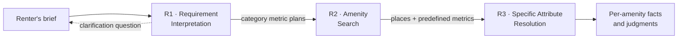
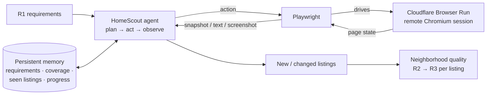
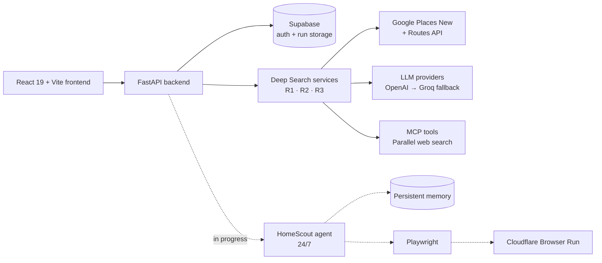

# HomeScout AI

**An agentic apartment-search assistant. You describe the home and neighborhood you want in plain language; HomeScout's agents search, evaluate and follow up for you in the background, and keep you in the loop.**

HomeScout looks past raw listings and map results. It interprets your stated priorities, infers what you would plausibly care about but didn't mention, finds the amenities around an apartment, and digs up the specific facts that decide whether each one actually fits you — with real travel times and judgments you can trace back to their evidence.

> **Project status:** rapid, active development. **Deep Search** is done: its neighborhood-quality pipeline (requirement interpretation → amenity search → specific attribute resolution) runs as three independent, resumable backend services. The current focus is the **[Apartment Search Agent with a persistent memory layer](#apartment-search-agent-with-persistent-memory-247-current-focus)**, which searches for apartments 24/7.

---

## The problem

Choosing an apartment, and judging whether its neighborhood works for you, is tedious and manual:

- You search for apartments on many websites, at different times, with no way to compare options across platforms.
- You message dozens of owners and lose track of who replied and what they said.
- You can't tell, without hours of research, whether an apartment is even worth inquiring about.
- You look up each amenity type one at a time and cross-check distances yourself — there's **no single view of whether your actual list of priorities is met.**
- A generic search returns **every** "gym" or "park", whether or not it has the specific quality you wanted, so you check each one by hand.
- A distance number hides whether the route is walkable, crosses a highway, or takes far longer than the straight line suggests.
- If you forget to ask about a category, you never see it — even when it would have changed your decision.

## What HomeScout does

The product is organized into five features:

| # | Feature | Purpose |
| --- | --- | --- |
| 1 | **Deep Search** ✅ | Interpret the renter's brief and run the agentic workflows that gather evidence |
| 2 | **Deep Analysis** | Evaluate each apartment and its neighborhood against that evidence |
| 3 | **Matching Engine** | Rank apartments by fit to the renter's priorities |
| 4 | **Owners Outreach** | Contact owners, follow up, and keep each conversation in one thread |
| 5 | **User Feedback** | Learn from the renter's reactions to refine later searches |

**Deep Search** takes the renter's instructions and triggers agentic workflows for three areas:

1. **Neighborhood quality** — ✅ done (see below)
2. **Apartment listings on the web** — 🚧 current focus: the [Apartment Search Agent with persistent memory](#apartment-search-agent-with-persistent-memory-247-current-focus)
3. **Apartment quality** — 📋 planned

---

## Deep Search: neighborhood quality

Neighborhood quality is built as three **responsibilities** (R1–R3). Each is an independent backend service: it can be started, polled and retried on its own, runs per user, and saves its costly steps so a retry resumes where it stopped instead of starting over. Each stage's saved output is the next stage's input.



### R1 — Requirement Interpretation ✅

Turns a messy, natural-language brief ("quiet café with wifi, a gym I can walk to, I have a toddler") into a per-category specification: **reason, priority, depth and metrics**. No searching happens here — R1 only decides _what_ to look for and _how hard_.

| Mechanism | What it does |
| --- | --- |
| **Extraction** | Splits the brief into explicit categories, desired characteristics, ambiguity flags and persona/lifestyle facts. |
| **Category resolution + clarification** | Maps each stated category to a maintained amenity taxonomy. When a category is ambiguous, the run **pauses**, asks the renter one grounded question, and resumes against the answer. |
| **Persona inference** | Adds a small number of categories the renter didn't state but would plausibly want ("toddler" → playgrounds), always ranked below explicit priorities. |
| **Depth assignment** | Gives every category one depth level, so later stages spend more effort where the renter cares more. |
| **Metric definition** | Defines the metrics that decide fit for each category. Each metric carries an **evidence class** — _factual_ (opening hours, has wifi) or _experiential_ (is it quiet?) — which later decides which sources may answer it. |

### R2 — Amenity Search ✅

Takes R1's plans plus the apartment's location and finds the real places around it.

- **Place discovery** — searches Google Places (New) around the origin for every category.
- **Accessibility enrichment** — measures real travel access with Google Routes: route, mode (walk, cycle, drive, transit) and time, not straight-line distance.
- **Result attachment** — records each place's predefined quality metrics (rating, hours, price level, routing views…) as one `PredefinedMetricsRecord` per place per category.

### R3 — Specific Attribute Resolution ✅

Generic place data can't answer "does this café have reliable wifi?" or "is this gym crowded in the evening?". R3 answers the renter's **own** dynamically-defined metrics for every discovered amenity.

- **Website discovery + official-URL gate** — finds each place's official website and checks that it really belongs to that place.
- **Evidence acquisition (Phase-1 loop)** — an LLM tool-calling loop runs targeted web searches (Parallel Search over MCP) for every metric and stores the evidence per metric.
- **Resolution** — a final structured LLM turn commits a value per metric from that evidence, following source rules: official-site evidence beats third-party evidence for factual metrics; reviews are accepted only for experiential metrics.
- A run-wide circuit breaker stops the run cleanly when a provider is down, instead of saving empty answers.
- Deeper page scraping (Firecrawl) is designed and kept in the data model, but deferred.

### What the renter gets

- **Preference-matched amenities** — the categories you named at full priority, plus a small baseline set you didn't think to mention.
- **Right-depth detail** — more information where you care more, less where you don't.
- **Real accessibility** — travel-based route, mode and time.
- **Characteristic matching** — a "quiet café with wifi", or a close alternative, not every café found.
- **Traceable judgments** — every assessment kept separate from the facts it came from, so you can see _why_, not just a verdict.

---

## Apartment Search Agent with persistent memory, 24/7 (current focus)

The next Deep Search area finds **apartment listings across the web** on the renter's behalf — not as a one-off search, but as an agent that **keeps searching around the clock** and remembers everything it has done. New listings appear and disappear all day; a renter can't watch every site, so the agent does it for them and reports only what's new and relevant.

Listing sites differ in layout, need filters typed and clicked, paginate, and render with JavaScript — so instead of a scraper per site, HomeScout uses an **agent that operates a real browser**, backed by a **memory layer** that lets it work continuously. Four components work together:

| Component | Role |
| --- | --- |
| **HomeScout agent** — _the brain_ | Turns the renter's interpreted requirements (R1 output: budget, area, must-haves) into a search plan: which sites to visit, which filters to apply, which listings to open. It then runs that plan step by step — reading what the page shows, choosing the next action, recovering when something unexpected appears — and extracts each listing into one structured, comparable record. |
| **Playwright** — _the hands_ | The action layer. Every decision the agent makes becomes a Playwright operation: navigate, click, type into a search box, select a filter, scroll, wait for results. It also hands observations back to the agent (accessibility snapshot, page text, screenshots) so the agent can decide the next step. |
| **Cloudflare Browser Run** — _the environment_ | Hosted, isolated headless Chromium sessions on Cloudflare's network. Playwright connects to these remote browsers instead of launching one on our server, so searches run in the background, several sites can be searched in parallel, and nothing heavy runs on the HomeScout backend. |
| **Persistent memory layer** — _the long-term memory_ | Stores what the agent must not forget between runs: the renter's requirements and feedback, which sites and searches it has covered and when, every listing it has already seen (so it never reports the same one twice and notices price or availability changes), and where each in-flight search stopped. Because this state lives outside any single browser session, the agent can run on a schedule 24/7, survive restarts, and pick up exactly where it left off. |

**How they come together:**



1. On every cycle (scheduled, around the clock), the agent loads its memory: the renter's requirements, what it has already covered, and the listings it has already seen.
2. It plans this cycle's search — which sites to revisit, which new searches to try, which unfinished search to resume.
3. For each site, it opens a remote browser session on Cloudflare Browser Run through Playwright.
4. The loop repeats — **the agent picks an action → Playwright performs it in the remote browser → the resulting page state comes back to the agent** — until the results are collected.
5. It extracts each listing (price, size, address, photos, source URL) into a common format and checks it against memory: new listings and changed ones (price drop, back on the market) move forward; ones already seen are skipped.
6. It writes the cycle's progress and findings back to memory, so the next cycle — or a restart after a failure — continues from there.
7. Each new listing's address becomes the origin for the neighborhood-quality pipeline (R2 → R3), and the results flow on to Deep Analysis and the Matching Engine. The renter is kept in the loop with live progress and notifications about what's new.

> Status: in design and early implementation.

---

## Status

| Area | Status |
| --- | --- |
| Deep Search — R1 Requirement Interpretation (service + HTTP API, pause/resume, retry) | ✅ Built |
| Deep Search — R2 Amenity Search (service + HTTP API, retry) | ✅ Built |
| Deep Search — R3 Specific Attribute Resolution (service + HTTP API, retry) | ✅ Built |
| Frontend — Home page with requirement interpretation UI (R1) | ✅ Built |
| Frontend — Amenity search and attribute resolution views | 📋 Planned |
| Apartment Search Agent, 24/7 (HomeScout agent + persistent memory + Playwright + Cloudflare Browser Run) | 🚧 Current focus |
| Deep Analysis, Matching Engine, Owners Outreach, User Feedback | 📋 Planned |

## Architecture



Every Deep Search run is stored per user in Supabase (`r1_runs`, `r2_runs`, `r3_runs` and their step tables), which is what makes runs pollable, private and resumable.

### HTTP API

All endpoints require an authenticated session.

| Service | Start | Status | Retry | Other |
| --- | --- | --- | --- | --- |
| R1 Requirement Interpretation | `POST /api/requirement-interpretation/runs` | `GET …/runs/{run_id}` | `POST …/runs/{run_id}/retry` | `POST …/runs/{run_id}/clarification-answers` |
| R2 Amenity Search | `POST /api/amenity-search/runs` | `GET …/runs/{run_id}` | `POST …/runs/{run_id}/retry` | — |
| R3 Specific Attribute Resolution | `POST /api/specific-metric-resolution/runs` | `GET …/runs/{run_id}` | `POST …/runs/{run_id}/retry` | — |

Long-running runs (R2, R3) start in the background and return `202` with a `run_id`; the client polls the status endpoint.

### Repository layout

| Path | What's there |
| --- | --- |
| [`backend/`](backend/) | FastAPI service: auth, Deep Search services, HTTP API. See [`backend/README.md`](backend/README.md). |
| [`backend/src/services/deep_search/`](backend/src/services/deep_search/) | R1/R2/R3 services, run coordinators and stores, prompts, schemas and tests. |
| [`backend/src/services/deep_search/feature_context/`](backend/src/services/deep_search/feature_context/) | Specs, architecture decisions and implementation plans for every mechanism. |
| [`backend/src/clients/`](backend/src/clients/) | Google Places/Routes, LLM provider and MCP tool gateway clients. |
| [`backend/supabase/`](backend/supabase/) | Database migrations (Supabase CLI project). |
| [`frontend/`](frontend/) | React 19 + Vite + Tailwind/shadcn single-page app. |

## Getting started

**Prerequisites:** Python 3.13, Node.js, Docker (optional), and API keys for OpenAI/Groq, Google Maps (Places + Routes) and Parallel (web search for R3).

```bash
git clone <repo-url>
cd HomeScout_AI
```

Create each app's environment file from its example and fill in your values:

```bash
cp backend/.env.example backend/.env
```

```bash
cp frontend/.env.example frontend/.env
```

**Backend:**

```bash
cd backend
pip install -r requirements.txt
uvicorn src.app.main:app --port 8000
```

**Frontend:**

```bash
cd frontend
npm install
npm run dev
```

**Or run both with Docker Compose:**

```bash
docker-compose up
```

**Tests:**

```bash
cd backend && pytest
```

```bash
cd frontend && npm run test:run
```

> Detailed backend setup (local HTTPS, environment reference) is in [`backend/README.md`](backend/README.md).

## License

See [`LICENSE`](LICENSE).
